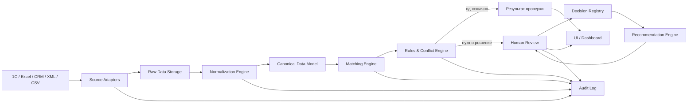
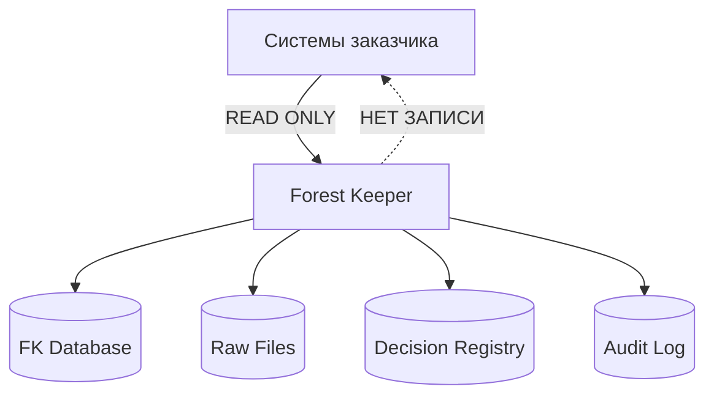

# Forest Keeper — Architecture v0.1

## 1. Назначение

Forest Keeper принимает данные из различных корпоративных источников, сопоставляет одинаковые сущности, выявляет расхождения и нарушения правил, передаёт неоднозначные случаи человеку и сохраняет принятые решения.

Ключевой принцип MVP:

**Forest Keeper читает исходные системы, но не изменяет их.**

Запись выполняется только во внутреннее хранилище FK.

---

## 2. Общая архитектура



---

## 3. Источники данных

На первом этапе FK должен уметь принимать:

- выгрузки из 1С;
- Excel;
- CSV;
- XML;
- впоследствии данные CRM;
- позднее прямые API-подключения.

Каждый источник подключается через отдельный **Source Adapter**.

Сам движок FK не должен знать, пришли данные из 1С или Excel. После адаптера они переводятся во внутренний формат.

---

## 4. Source Adapters

Задача адаптера:

1. принять файл или данные из системы;
2. определить формат;
3. извлечь строки и атрибуты;
4. сохранить исходные данные без изменений;
5. передать их в слой нормализации.

Пример:

```text
1С XML
    ↓
1C XML Adapter
    ↓
Raw Object
```

Адаптер ничего не исправляет и не решает, какое значение правильное.

---

## 5. Raw Data Storage

FK должен сохранять исходные данные в том виде, в котором они были получены.

Это необходимо для:

- аудита;
- повторной обработки;
- расследования ошибок;
- доказательства происхождения значения.

Например:

```text
Source: 1C
File: export_2026_09_29.xml
Object: MATERIAL-00321
Attribute: weight
Value: 12.45
```

Исходное значение никогда не затирается нормализованным.

---

## 6. Canonical Data Model

Внутри FK должна существовать собственная унифицированная модель данных.

Например:

```text
Material
 ├─ identifier
 ├─ name
 ├─ designation
 ├─ mass
 ├─ unit
 ├─ manufacturer
 └─ source
```

Но эта модель **не означает**, что заказчик обязан перестроить под неё свои системы.
Она нужна FK только как внутренний язык для сравнения разных источников.

Например:

```text
1С: "Вес нетто"
Excel: "Масса"
CRM: "Weight"
→ FK Canonical Attribute: mass
```

---

## 7. Normalization Engine

Normalization Engine приводит данные к сопоставимому виду.

Он может:

- привести единицы измерения;
- нормализовать регистр;
- убрать технические пробелы;
- привести даты к одному формату;
- нормализовать обозначения;
- распознать эквивалентные названия атрибутов.

Пример:

```text
12,5 кг
12500 г
12.500 KG
```

могут быть приведены к:

```text
mass = 12.5 kg
```

Нормализация не определяет, какое исходное значение является истинным.

---

## 8. Matching Engine

Matching Engine отвечает на вопрос:

> Какие записи из разных источников описывают один и тот же реальный объект?

Например:

```text
1С:
Вал приводной АБВГ.123456.001

Excel:
АБВГ-123456-001 / Вал привода
```

FK должен определить вероятность того, что это один объект.

Результат может содержать:

```text
Match confidence: 96%
```

Для сомнительных сопоставлений должно требоваться подтверждение человека.

---

## 9. Rules & Conflict Engine

После сопоставления объектов FK сравнивает их атрибуты.

Например:

```text
Объект: АБВГ.123456.001

1С:
Масса = 12.5 кг

Excel:
Масса = 13.2 кг
```

FK создаёт:

```text
Conflict CF-000145
Attribute: mass
Source A: 1C → 12.5 kg
Source B: Excel → 13.2 kg
Status: NEEDS_REVIEW
```

Конфликт может возникать не только между двумя значениями, но и из-за:

- отсутствующего атрибута;
- нарушения формата;
- нарушения бизнес-правила;
- подозрительного значения;
- дубликата;
- неизвестного источника истины;
- аномалии.

---

## 10. Human Review

Если система не может безопасно принять решение, случай передаётся человеку.

Интерфейс должен показывать:

```text
Объект:
Вал АБВГ.123456.001

Атрибут:
Масса

1С:
12.5 кг

Excel:
13.2 кг

Предыдущее похожее решение:
12.5 кг из 1С

Рекомендация FK:
Использовать значение 1С

[Принять рекомендацию]
[Выбрать Excel]
[Указать другое значение]
[Недостаточно информации]
```

---

## 11. Decision Registry

Это отдельный ключевой компонент Forest Keeper.
Он хранит **подтверждённые решения людей**.

Пример записи:

```json
{
  "decision_id": "DEC-000231",
  "object_type": "Material",
  "object_id": "АБВГ.123456.001",
  "attribute": "mass",
  "sources": {
    "1C": "12.5",
    "Excel": "13.2"
  },
  "decision": "12.5",
  "authoritative_source": "1C",
  "decision_type": "HUMAN_CONFIRMED",
  "reason": "1С используется как источник массы для данного типа объектов",
  "user": "Иванов И.И.",
  "timestamp": "2026-09-29T13:40:00"
}
```

Для MVP это может храниться в PostgreSQL.
Дополнительный контекст удобно хранить в `JSONB`.

---

## 12. Recommendation Engine

Recommendation Engine использует предыдущие решения экспертов.

При новом конфликте он:

1. определяет тип объекта;
2. определяет конфликтующий атрибут;
3. ищет похожие случаи;
4. анализирует подтверждённые решения;
5. формирует рекомендацию;
6. показывает основание рекомендации пользователю.

Например:

```text
Рекомендация: использовать значение из 1С.

Основание:
7 похожих случаев.
В 6 случаях эксперт подтвердил 1С.
В 1 случае решение было другим.

Confidence: 86%
```

Это уже позволяет честно говорить:

> **Forest Keeper обучается на подтверждённых решениях экспертов и использует накопленный опыт при обработке новых случаев.**

Но окончательное решение в MVP остаётся за человеком.

---

## 13. AI-слой

AI не должен быть единственным местом хранения знаний.

Архитектурно:

```text
AI ≠ Memory
```

Память предприятия хранится структурированно:

```text
Decision Registry
Rules
Canonical Model
Mappings
Audit Log
```

AI использует эти данные как контекст.

Это позволяет:

- объяснить рекомендацию;
- повторить результат;
- проверить, почему решение было принято;
- заменить модель AI без потери накопленных знаний.

---

## 14. Authoritative Source

Для каждого типа данных или даже отдельного атрибута FK может хранить предпочтительный источник.

Например:

```text
Material.name → ERP
Material.mass → PLM
Supplier.INN → 1C
Warehouse.balance → WMS
```

При этом допускается:

```text
Authoritative Source = NOT_DEFINED
```

То есть FK не обязан притворяться умнее предприятия, когда никто ещё не знает, где правда.

---

## 15. Audit Log

Каждое значимое действие записывается:

- какой файл загружен;
- кем;
- когда;
- какие объекты созданы;
- какие сопоставления найдены;
- какие конфликты выявлены;
- какую рекомендацию дал FK;
- что выбрал пользователь;
- какие правила использовались.

Аудит нельзя изменять обычному пользователю.

---

## 16. Пользователи и роли

Минимально:

```text
USER
REVIEWER
DATA_OWNER
ADMIN
```

Один человек может иметь несколько ролей.
Должность сотрудника и роль в FK являются разными сущностями.

---

## 17. Интерфейс

Основные разделы:

```text
Главная
Данные
Проблемы
Решения
Аналитика
Аудит
```

Для администратора дополнительно:

```text
Администрирование
 ├─ Пользователи
 ├─ Источники
 ├─ Модель данных
 ├─ Маппинг атрибутов
 ├─ Правила
 └─ Настройки
```

---

## 18. Основной поток MVP

```text
1. Пользователь загружает XML из 1С.
2. Пользователь загружает Excel.
3. FK сохраняет исходные файлы.
4. Адаптеры разбирают данные.
5. Normalization Engine приводит значения к внутреннему формату.
6. Matching Engine сопоставляет объекты.
7. Rules & Conflict Engine сравнивает атрибуты.
8. FK обнаруживает конфликт.
9. Recommendation Engine ищет похожие подтверждённые случаи.
10. Пользователь принимает решение.
11. Решение записывается в Decision Registry.
12. При следующем похожем случае FK использует накопленный опыт.
```

---

## 19. Что MVP НЕ делает

Версия `0.1`:

- не изменяет данные в 1С;
- не изменяет Excel;
- не пишет обратно в CRM;
- не принимает критические решения автоматически;
- не объявляет AI абсолютным источником истины;
- не требует перестройки процессов заказчика;
- не требует заменить существующие справочники клиента.

FK сначала **наблюдает, сопоставляет, объясняет и учится на подтверждённых решениях**.

---

## 20. Минимальный технический стек

Для первого прототипа:

```text
Frontend:
Next.js + TypeScript

Backend:
Python / FastAPI

Database:
PostgreSQL

Flexible context:
PostgreSQL JSONB

Files:
Object/File Storage

AI:
LLM abstraction layer

Repository:
GitHub

Deployment:
Docker
```

Векторную БД имеет смысл добавлять только тогда, когда обычного поиска по Decision Registry действительно перестанет хватать.

---

## 21. Архитектурная граница v0.1



Главная граница первого прототипа:

> **Forest Keeper может читать мир заказчика, но пока не имеет права его менять.**

А внутри своей системы он уже накапливает структурированное знание о данных, конфликтах и решениях экспертов.

Это и есть базовая **Architecture v0.1 Forest Keeper**.
