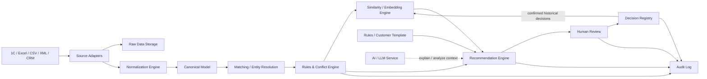
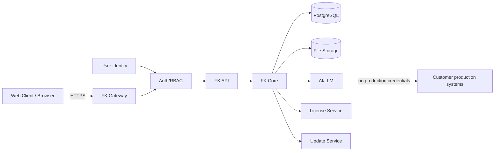

# Forest Keeper — Architecture v0.2

## 1. Общий принцип

Forest Keeper — серверная корпоративная система с защищённым клиентским доступом.

Архитектура делится на:
- клиентский слой;
- сервер Forest Keeper;
- внутренние сервисы обработки данных;
- хранилища;
- AI/Recommendation контур;
- лицензирование;
- обновление;
- интеграции с системами заказчика.

Для MVP логические компоненты не обязаны быть отдельными микросервисами. Их можно реализовать как модули одного backend-приложения и разделять физически только по мере необходимости.

## 2. Клиентский слой

Backend/API не должен зависеть от конкретного типа клиента.

### Web Client — основной клиент MVP

Основной пользовательский интерфейс Forest Keeper работает в браузере.

- React/TypeScript frontend;
- доступ к FK Server только по HTTPS через API Gateway;
- прямого доступа к PostgreSQL, файловому хранилищу и внутренним сервисам нет;
- авторизация и RBAC выполняются на сервере;
- разворачивается внутри инфраструктуры заказчика;
- должен поддерживать работу в закрытом контуре без доступа в Интернет.

Web Client используется для:
- просмотра и загрузки данных;
- запуска анализа;
- просмотра конфликтов;
- Human Review;
- принятия решений;
- просмотра рекомендаций и истории похожих решений;
- администрирования в пределах выданных ролей.

### Граница клиентского интерфейса

Web Client — единственное поддерживаемое направление. Desktop Client исключён из scope и roadmap решением от 21 октября 2026. Backend/API отделён от frontend как архитектурная граница; это не обещание второго клиента.

## Статус реализации

Компоненты и потоки ниже — целевая архитектура MVP. В main реализованы этапы 0–3: вход, импорт и нормализация. Matching находится в отдельном PR; Conflict/Decision/recommendation/AI runtime пока отсутствуют. Актуальная [матрица готовности](../deployment/review-readiness.md) отделяет архитектурные требования от доступных функций.

## 3. Серверный контур

Основные компоненты:

- API Gateway;
- Authentication / Authorization;
- License Service;
- Update Service;
- Backend / Application Service;
- Source Adapters;
- Raw Data Storage;
- Normalization Engine;
- Canonical Data Model;
- Matching / Entity Resolution Engine;
- Rules & Conflict Engine;
- Decision Registry;
- Similarity / Embedding Engine;
- Recommendation Engine;
- AI / LLM Service;
- Audit Log;
- PostgreSQL;
- File/Object Storage;
- Background Jobs / Queue.

## 4. Основной поток данных



## 5. Адаптивная модель

Ключевая особенность FK:

```
Базовый шаблон FK
        ↓
Настройки клиента
        ↓
Анализ данных
        ↓
Решение пользователя
        ↓
Decision Registry
        ↓
Поиск похожих решений
        ↓
AI/Recommendation
        ↓
Новая рекомендация
        ↓
Предложение изменить правило/шаблон
        ↓
Human Approval
        ↓
Настроенная модель клиента
```

FK не должен автоматически менять правила после каждого решения.

Если одинаковая практика повторяется, система может предложить:
«В похожих случаях вы систематически выбираете это правило. Закрепить его в настройках?»

Только после подтверждения человека изменение становится формальным правилом клиента.

## 6. AI / LLM

AI — не декоративный компонент.

Его назначение:
- анализировать контекст нового случая;
- использовать найденные похожие подтверждённые решения;
- формировать объяснимую рекомендацию;
- объяснять, на каком прошлом опыте основана рекомендация;
- помогать выявлять устойчивые паттерны поведения клиента.

AI не является корпоративной памятью.

Память находится в:
- Decision Registry;
- правилах;
- mappings;
- master/canonical model;
- Audit.

AI не имеет production credentials и не пишет напрямую в системы заказчика.

## 7. Форматы обмена

### Web Client ↔ Server
HTTPS + JSON DTO.

### Внутренние API
По умолчанию JSON через HTTP/REST или внутренние вызовы модулей для монолита MVP.

### Внешние источники
- 1C XML;
- XLSX;
- CSV;
- JSON;
- API JSON/XML при наличии интеграции.

### DB
SQL через драйвер PostgreSQL.

### AI
Структурированный JSON request/response.

Большие исходные файлы передаются в файловое/object storage, а между компонентами передаётся ID/ссылка на объект, а не копия файла.

## 8. Лицензирование

License Service — серверный компонент FK.

Он проверяет:
- цифровую подпись лицензии;
- клиента;
- срок действия;
- редакцию;
- модули;
- ограничения;
- срок поддержки;
- optional installation/server binding.

Поддерживаются:
- online activation/renewal;
- offline signed license file.

## 9. Обновления

Update Service поддерживает:
- online update;
- offline signed update package;
- проверку подписи;
- проверку совместимости;
- backup;
- migration;
- health check;
- rollback.

## 10. Deployment

Рекомендуемый способ:
- контейнеризированные серверные компоненты;
- один корпоративный installer скрывает внутреннюю Docker/container механику;
- Web Client поставляется вместе с серверной частью и открывается в браузере;
- поддержка полностью offline установки в закрытом контуре.

## 11. Trust boundary



## 12. Ключевые ограничения MVP

- Web Client is the primary client;
- Desktop Client excluded from product scope;
- source systems read-only;
- no autonomous production write;
- human final decision;
- AI recommendation must be explainable;
- unknown truth remains UNKNOWN / NEEDS_REVIEW;
- customer data remains accessible to customer even when license expires, subject to configured read-only/grace behavior.
