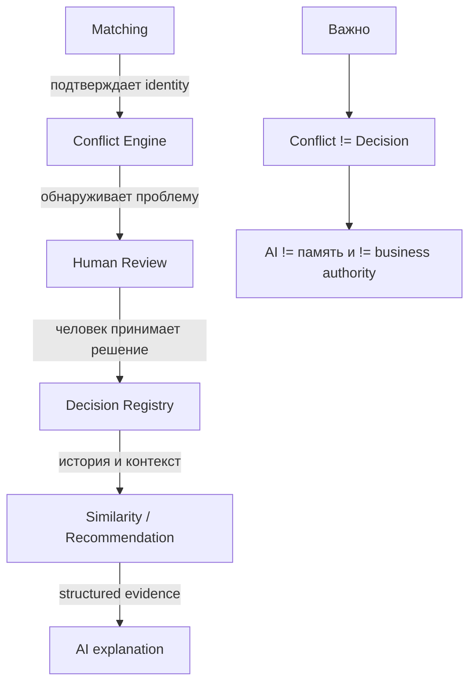
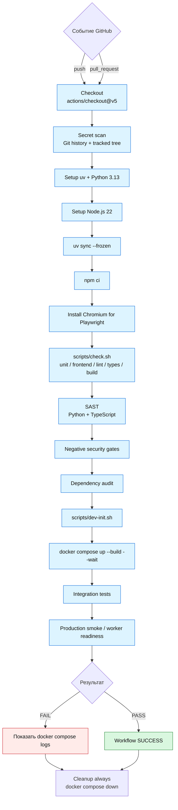

# Forest Keeper — блок-схема процесса и CI

**Актуально на 25 октября 2026:** Stage 0–7 приняты в `main`. Stage 7 — [PR #28](https://github.com/SergeyRassohin/Forest-Keeper/pull/28), merge `c927af513d29d83bd53b1b6522efccb42b5a1341`, [CI точного merge commit — SUCCESS](https://github.com/SergeyRassohin/Forest-Keeper/actions/runs/40079346518). Production embedding provider отключён; synthetic test provider не доказывает промышленное качество. Stage 8 Recommendation Engine начат по [issue #29](https://github.com/SergeyRassohin/Forest-Keeper/issues/29): владелец утвердил численную policy 25 октября; реализация и приёмка в отдельном PR #30 продолжаются. Recommendation runtime, AI/LLM и write-back отсутствуют; #17/#18/#20 открыты.

Актуально для `main` после принятия Stage 5 по ТЗ в [issue #21](https://github.com/SergeyRassohin/Forest-Keeper/issues/21).

## 1. Бизнес-процесс Forest Keeper

```mermaid
flowchart LR
    A["Импорт данных<br/>CSV / XLSX / XML"] --> B["RawRecord<br/>immutable + provenance"]
    B --> C["Нормализация<br/>versioned profile"]
    C --> D["Matching / Entity Resolution<br/>Stage 4 — ACCEPTED"]
    D --> D1{"Результат"}
    D1 -->|MATCHED| E["Единая идентичность<br/>без выбора 'истинного' значения"]
    D1 -->|POSSIBLE_MATCH| F["Ручная проверка identity"]
    D1 -->|NOT_MATCHED| G["Разные сущности"]

    E --> H["Conflict Engine<br/>Stage 5 — ACCEPTED"]
    F -->|подтверждено MATCHED| E
    F -->|отклонено NOT_MATCHED| G
    H --> I["Conflict + evidence + provenance"]
    I --> J["Human Review<br/>Stage 6"]
    J --> K["Decision Registry<br/>Stage 6 · immutable history"]
    K --> L["Similar Decision Retrieval<br/>Stage 7 / pgvector · test only"]
    L --> M["Deterministic Recommendation<br/>Stage 8 · proposal"]
    M --> N["Qwen explanation<br/>Stage 9 · future"]
    N --> O["Новый похожий случай"]
    O --> L

    classDef done fill:#d9f7df,stroke:#238636,color:#111;
    classDef next fill:#fff0c2,stroke:#bf8700,color:#111;
    classDef future fill:#eaeef2,stroke:#57606a,color:#111;

    class A,B,C,D,D1,E,F,G,H,I,J,K,L done;
    class M next;
    class N,O future;
```

**Текущий статус:** этапы 0–7 приняты в main: Human Review + Registry через PR #26, bounded retrieval через PR #28 (exact merge CI 40079346518 SUCCESS). PR #22 объединён владельцем в main: `6235dd6a18f8cbb8aeceac2a7d052f5fca396482`; [CI точного merge commit — SUCCESS](https://github.com/SergeyRassohin/Forest-Keeper/actions/runs/39768647312). Этап 5 принят; 679 тестов и независимый runtime/security/product-intent retest PASS. Шаг Stage 5 из #20 завершён. Stage 6 принят через PR #26, Stage 7 — через PR #28; #18/#20 остаются открытыми. Только подтверждённые MATCHED identities создают business Conflict; отклонённые пары не анализируются как одна сущность. Stage 7 принят как bounded retrieval; production semantic provider/recommendation/AI полного MVP ещё отсутствуют.

### Граница ответственности этапов

Stage 5 не выбирает «истинное» значение, не создаёт Decision и не использует LLM как доказательство. `RULE_VIOLATION` допустим только по явному versioned rule source; `ANOMALY` — только при воспроизводимом detector.

## 2. GitHub Actions workflow

В репозитории сейчас один workflow: `.github/workflows/ci.yml`, имя **MVP foundation**. Он запускается на `push` и `pull_request`.

### Stage gate для каждого следующего этапа

```mermaid
flowchart LR
    A["Отдельная ветка / PR"] --> B["Self-review + tests"]
    B --> C["Security / dependency gates"]
    C --> D["Independent retest"]
    D --> E["Architecture / Product Intent Gate"]
    E --> F["Green CI на final HEAD"]
    F --> G["Явное разрешение владельца"]
    G --> H["Merge в main"]
    H --> I["Green CI exact merge commit"]
    I --> J["Этап ACCEPTED"]
```

Автоматический merge для стадий, требующих отдельной приёмки, не используется.

### Что означают старые красные runs

GitHub сохраняет историю запусков. Старые `failure` относятся к старым commit SHA и не делают текущий `main` красным.

Для текущего состояния важны проверки **конкретного SHA**. После принятия Stage 4:

- merge commit Stage 4 `bea0d55c92540744657feac863084cde131a7f43` — CI **SUCCESS**;
- последующий documentation-only commit `8ef8a16a5b37d1e680ab88ffbbf9b42a2e9c3f09` — CI **SUCCESS**.

При приёмке Stage 5 применяется то же правило: зелёный CI на финальном HEAD PR, отдельное разрешение на merge, затем зелёный CI на точном merge commit в `main`.

## 3. Связанные материалы

- [Stage 5 ТЗ — issue #21](https://github.com/SergeyRassohin/Forest-Keeper/issues/21)
- [MVP readiness — issue #18](https://github.com/SergeyRassohin/Forest-Keeper/issues/18)
- [сквозной план до внешней проверки — issue #20](https://github.com/SergeyRassohin/Forest-Keeper/issues/20)
- [презентация продукта](../marketing/presentation-v0.1.md)

## Stage 5: принят в main — 22 октября 2026

PR #22 объединён владельцем в main: `6235dd6a18f8cbb8aeceac2a7d052f5fca396482`; [CI точного merge commit — SUCCESS](https://github.com/SergeyRassohin/Forest-Keeper/actions/runs/39768647312). Этап 5 принят; 679 тестов и независимый runtime/security/product-intent retest PASS. Шаг Stage 5 из #20 завершён. Stage 6 принят через PR #26, Stage 7 — через PR #28; #18/#20 остаются открытыми. Полный MVP #18/#20 остаётся незавершённым.

## Stage 6: фактический путь, принятый в main

Import → Normalization → Matching → persisted Conflict → Human Review → immutable Decision → audit/history. Decision хранится в PostgreSQL; review path не вызывает AI/Redis jobs и не пишет в исходные системы. Авторизацию обеспечивает backend. Исправление создаёт новую запись со ссылкой на прежнюю. См. [реализованный workflow](../development/human-review.md).

## Stage 7: фактическая граница принятого bounded retrieval

New Conflict → scoped context → background query vector → eligible resolved Decision pool → compatibility filters → complete active pgvector version → cosine top-N → actual Decision/history. `Similarity != Recommendation != Decision`. Production provider unavailable; deterministic test vectors only in explicit synthetic test/development configuration. [Описание](../development/similarity-retrieval.md).

Stage 8 Recommendation Engine пока имеет [предложение архитектуры и численной policy](../development/stage8-recommendation-proposal.md); implementation/owner approval/acceptance ещё не завершены. Следующий фактический Stage 9 — AI/LLM. Старые roadmap номера не меняют исторические отчёты.
