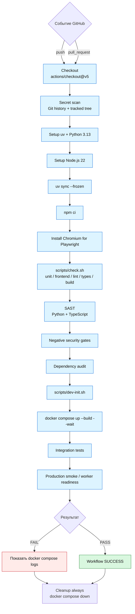

# Forest Keeper — блок-схема процесса и CI

Актуально для `main` после принятия Stage 4.

## 1. Бизнес-процесс Forest Keeper

```mermaid
flowchart LR
    A["Импорт данных<br/>CSV / XLSX / XML"] --> B["RawRecord<br/>immutable + provenance"]
    B --> C["Нормализация<br/>versioned profile"]
    C --> D["Matching / Entity Resolution<br/>Stage 4"]
    D --> D1{"Результат"}
    D1 -->|MATCHED| E["Единая идентичность<br/>без выбора 'истинного' значения"]
    D1 -->|POSSIBLE_MATCH| F["Ручная проверка identity"]
    D1 -->|NOT_MATCHED| G["Разные сущности"]

    E --> H["Conflict Engine<br/>Stage 5"]
    F --> H
    H --> I["Conflict + evidence + provenance"]
    I --> J["Human Review<br/>Stage 6"]
    J --> K["Decision Registry<br/>immutable history"]
    K --> L["Similar Decision Retrieval<br/>Stage 8 / pgvector"]
    L --> M["Deterministic Recommendation<br/>Stage 9"]
    M --> N["Qwen explanation<br/>Stage 10, optional"]
    N --> O["Новый похожий случай"]
    O --> L

    classDef done fill:#d9f7df,stroke:#238636,color:#111;
    classDef next fill:#fff0c2,stroke:#bf8700,color:#111;
    classDef future fill:#eaeef2,stroke:#57606a,color:#111;

    class A,B,C,D,D1,E,F,G done;
    class H,I next;
    class J,K,L,M,N,O future;
```

**Статус:** этапы 0–4 приняты в `main`. Следующий отдельный этап — Stage 5 Conflict Engine. Полный путь до Decision/retrieval/recommendation/AI ещё не завершён.

## 2. GitHub Actions workflow

В репозитории сейчас один workflow: `.github/workflows/ci.yml`, имя **MVP foundation**. Он запускается на `push` и `pull_request`.

### Что означают старые красные runs

GitHub сохраняет историю запусков. Старые `failure` относятся к старым commit SHA и не делают текущий `main` красным.

Для текущего состояния важны проверки **конкретного SHA**. После принятия Stage 4:

- merge commit Stage 4 `bea0d55c92540744657feac863084cde131a7f43` — CI **SUCCESS**;
- последующий documentation-only commit `8ef8a16a5b37d1e680ab88ffbbf9b42a2e9c3f09` — CI **SUCCESS**.

При приёмке каждого следующего этапа используется то же правило: зелёный CI на финальном HEAD PR, затем merge и зелёный CI на точном merge commit в `main`.
