# Forest Keeper — Object Lifecycles & State Models v0.1

Статус: обязательная спецификация состояний и переходов для MVP.

## 1. Назначение

Этот документ определяет жизненные циклы ключевых объектов Forest Keeper: какие состояния у них существуют, как объект попадает из одного состояния в другое, какие действия допустимы и какие переходы запрещены.

Цель — не дать backend, frontend, API и тестам придумать четыре разных трактовки одного и того же статуса. Если реализация требует нового состояния или перехода, которого здесь нет, сначала обновляется эта спецификация и связанный API-контракт.

Документ не заменяет Access Control Matrix. Здесь фиксируется **что вообще допустимо для объекта**. Кто именно имеет право выполнить действие, окончательно определяет матрица доступа.

---

## 2. Общие правила

1. Статусы хранятся как явные перечисления, а не как произвольный текст.
2. Переход состояния выполняется только через бизнес-операцию backend.
3. Frontend не имеет права самостоятельно объявлять объект изменившим состояние.
4. Каждый значимый переход фиксируется в Audit.
5. Исторические решения, raw-данные и audit-события не удаляются обычными пользовательскими операциями.
6. AI/LLM не имеет права самостоятельно переводить Conflict, Decision, Rule или RuleSuggestion в финальное подтверждённое состояние.
7. Если переход не описан в этой спецификации, он запрещён до явного проектного решения.

---

# 3. ImportBatch

## Назначение

ImportBatch представляет одну попытку загрузки и разбора исходного файла или набора данных.

## Состояния

- `NEW` — пакет зарегистрирован, исходный файл принят.
- `QUEUED` — задача поставлена в очередь фоновой обработки.
- `PROCESSING` — выполняется разбор файла и создание RawRecord.
- `COMPLETED` — обработка завершена без ошибок уровня записей.
- `COMPLETED_WITH_ERRORS` — пакет обработан, но часть записей не была разобрана.
- `FAILED` — пакет нельзя использовать как корректно завершённый импорт.

## Диаграмма

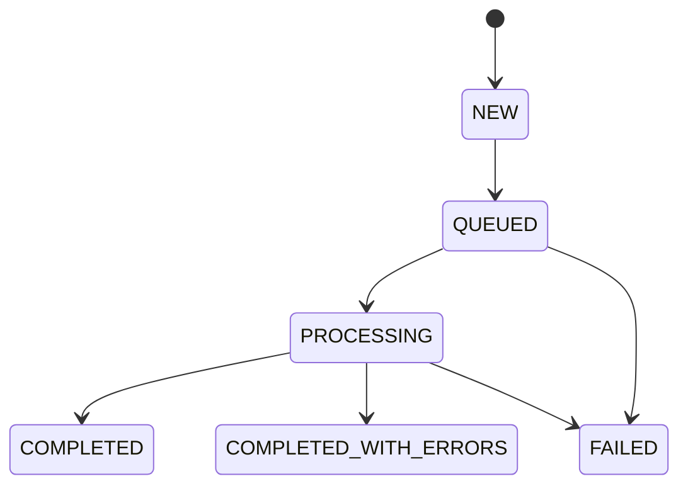

## Правила переходов

| Из | В | Причина |
|---|---|---|
| NEW | QUEUED | backend поставил импорт в очередь |
| QUEUED | PROCESSING | worker начал обработку |
| PROCESSING | COMPLETED | все допустимые записи обработаны успешно |
| PROCESSING | COMPLETED_WITH_ERRORS | пакет пригоден, но есть ошибки отдельных записей |
| QUEUED / PROCESSING | FAILED | системная ошибка, повреждённый файл или невозможность продолжить |

## Инварианты

- Оригинальный файл и checksum сохраняются независимо от результата разбора.
- `FAILED` не означает удаление исходного файла.
- RawRecord, уже созданные до частичной ошибки, не должны тихо исчезать.
- Повторный импорт создаёт новый ImportBatch; старый пакет не «переиспользуется» сменой статуса.

---

# 4. AnalysisRun

## Назначение

AnalysisRun представляет конкретный запуск цепочки нормализации, matching и обнаружения конфликтов по выбранным импортам и шаблону.

## Состояния

- `NEW`
- `QUEUED`
- `PROCESSING`
- `COMPLETED`
- `FAILED`

## Диаграмма

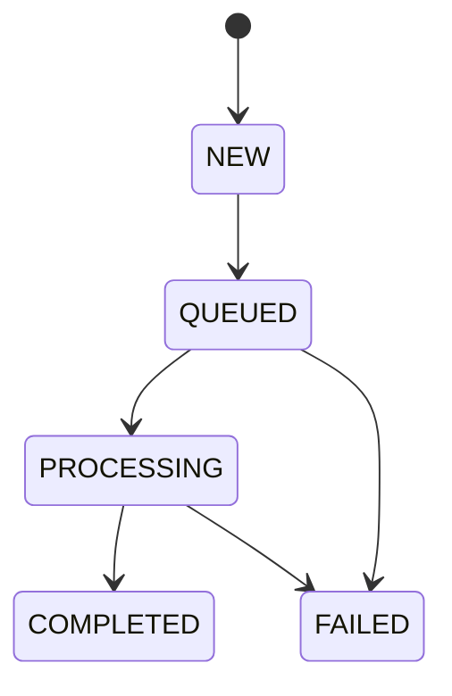

## Инварианты

- AnalysisRun связан с конкретными ImportBatch и версией правил/CustomerTemplate.
- Повторный анализ создаёт новый AnalysisRun.
- Результаты старого анализа не переписываются так, будто они были получены по новым правилам.
- Ошибка AI/LLM сама по себе не должна переводить весь AnalysisRun в `FAILED`, если детерминированные стадии анализа могут быть завершены без LLM.

---

# 5. MatchCandidate / результат Entity Resolution

## Назначение

MatchCandidate фиксирует предположение о том, что две или более исходные записи относятся к одной реальной сущности.

## Состояния

- `POSSIBLE_MATCH` — найден кандидат, уверенности недостаточно для окончательного связывания.
- `MATCHED` — записи признаны относящимися к одной сущности в рамках действующих правил matching.
- `NOT_MATCHED` — кандидат отклонён как разные сущности.

Для пользовательского интерфейса `POSSIBLE_MATCH` может отображаться как `NEEDS_REVIEW`, но в модели должен использоваться один канонический код состояния.

## Диаграмма

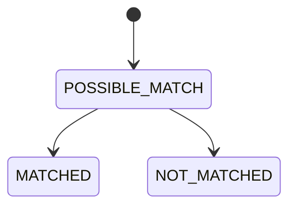

## Инварианты

- Match score является основанием, а не самим статусом.
- Порог автоматического `MATCHED` конфигурируем.
- Если уверенность находится в зоне ручной проверки, система не должна молча превращать кандидата в `MATCHED`.
- История основания сопоставления сохраняется: exact/rule/fuzzy/embedding/hybrid и рассчитанные значения.

---

# 6. Conflict

## Назначение

Conflict — ключевой объект Human Review. Он фиксирует обнаруженное расхождение, нарушение правила или другой случай, требующий объяснения и, при необходимости, решения человека.

## Состояния MVP

- `OPEN` — конфликт обнаружен и ещё не взят в работу.
- `IN_REVIEW` — конфликт открыт для рассмотрения и находится в процессе Human Review.
- `RESOLVED` — человек зафиксировал финальное решение либо явно подтвердил результат, закрывающий конфликт.
- `INSUFFICIENT_DATA` — человек подтвердил, что имеющихся данных недостаточно для достоверного решения.

`INSUFFICIENT_DATA` является **финальным результатом конкретного рассмотрения**, а не выдуманной системой истиной.

## Диаграмма

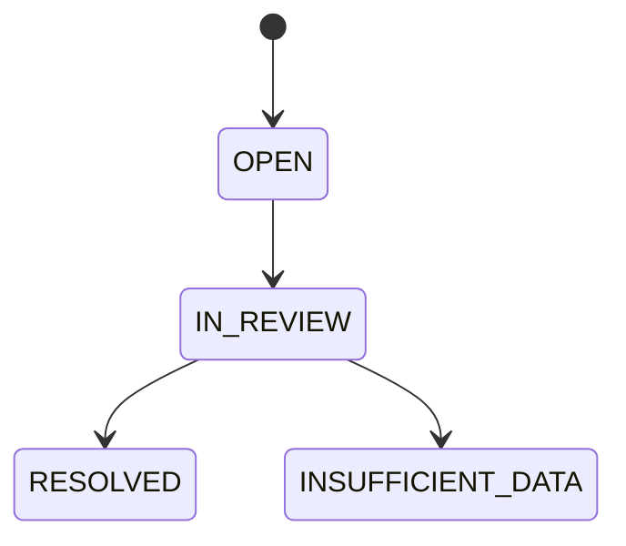

## Переходы

| Из | В | Инициатор | Условие |
|---|---|---|---|
| — | OPEN | Conflict Engine | обнаружен новый конфликт |
| OPEN | IN_REVIEW | авторизованный пользователь / backend | пользователь начал рассмотрение |
| IN_REVIEW | RESOLVED | REVIEWER или DATA_OWNER согласно RBAC | создан подтверждённый Decision |
| IN_REVIEW | INSUFFICIENT_DATA | REVIEWER или DATA_OWNER согласно RBAC | человек явно указал недостаточность данных |

## Запрещено

- `OPEN → RESOLVED` без Human Review и Decision.
- автоматический `RESOLVED` только потому, что confidence Recommendation высокий;
- изменение source-системы как побочный эффект закрытия Conflict;
- физическое удаление Conflict после закрытия.

## Повторное появление похожей проблемы

В MVP новый импорт или новый AnalysisRun, обнаруживший похожую проблему, **создаёт новый Conflict**. Старый Conflict не переводится обратно из `RESOLVED`.

Это принципиально: новый случай должен иметь собственный provenance, собственную Recommendation и собственный Decision, а прошлый Conflict выступает историческим прецедентом.

---

# 7. Recommendation

## Назначение

Recommendation — объяснимая рекомендация FK для конкретного Conflict. Она строится на текущем контексте, действующих правилах и подтверждённых прошлых решениях.

## Состояния

- `CURRENT` — рекомендация рассчитана на актуальном контексте Conflict.
- `STALE` — после её расчёта изменился значимый контекст: правила, шаблон, исходные данные, matching или набор релевантных решений.
- `SUPERSEDED` — для того же Conflict рассчитана новая Recommendation.

## Диаграмма

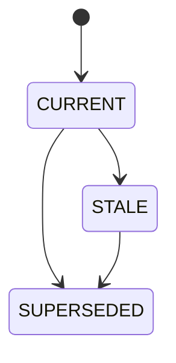

## Важное различие

У Recommendation **нет состояния ACCEPTED**.

Если пользователь соглашается с рекомендацией, создаётся Decision, который может ссылаться на Recommendation и фиксировать, что рекомендованное действие было принято. Recommendation остаётся доказательным объектом, а не становится человеческим решением задним числом.

## Инварианты

- Recommendation не создаёт Decision сама.
- Recommendation не меняет Rule сама.
- Recommendation не меняет source data.
- Recommendation должна хранить достаточный snapshot оснований: rules used, similar decisions, similarity score, reasoning summary, version/context.

---

# 8. Decision

## Назначение

Decision — подтверждённое решение человека по Conflict. Это часть корпоративной памяти Forest Keeper.

## Модель жизненного цикла

Decision является неизменяемой записью после создания.

Состояния:

- `ACTIVE` — действующее подтверждённое решение по конкретному рассмотрению.
- `SUPERSEDED` — решение сохранено в истории, но более позднее явное решение признано актуальным вместо него.

## Диаграмма

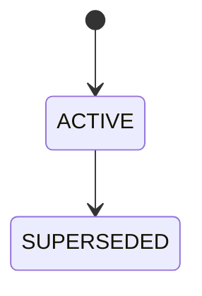

## Правила

- Decision создаётся только действием человека с достаточными правами.
- После сохранения нельзя переписать selected_value, actor, timestamp, conflict context или provenance.
- Исправление ошибочного решения выполняется созданием нового Decision, а старый становится `SUPERSEDED`.
- Удаление Decision обычной бизнес-операцией запрещено.
- Decision может ссылаться на Recommendation, которую пользователь видел при принятии решения.
- Решение `INSUFFICIENT_DATA` также должно быть структурированным Decision, а не только статусом Conflict.

## Почему так

Если разрешить редактировать старый Decision «на месте», Forest Keeper потеряет возможность честно ответить на вопрос: «что человек решил тогда и на основании каких данных?». Для системы, которая учится на подтверждённых решениях, это было бы особенно изящным способом отравить собственную память.

---

# 9. Rule

## Назначение

Rule — формализованное правило клиента или базовое правило Forest Keeper.

## Состояния MVP

- `DRAFT` — правило существует, но не участвует в анализе.
- `ACTIVE` — правило участвует в анализе новых AnalysisRun.
- `INACTIVE` — правило сохранено, но не применяется.

## Диаграмма

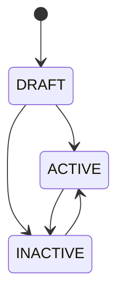

## Инварианты

- Изменение содержания активного правила должно создавать новую версию правила либо новую версию конфигурации, а не переписывать исторический смысл прошлых анализов.
- Прошлые AnalysisRun и Decision должны сохранять ссылку на ту версию Rule, которая действовала тогда.
- AI/LLM не переводит Rule в `ACTIVE`.
- LEARNED_PROPOSAL — это origin правила/предложения, а не разрешение на автоматическую активацию.

---

# 10. RuleSuggestion

## Назначение

RuleSuggestion — предложение Forest Keeper формализовать повторяющуюся подтверждённую практику пользователей.

## Состояния

- `OPEN` — предложение создано и ожидает решения.
- `ACCEPTED` — человек подтвердил предложение; создана/обновлена версия Rule.
- `REJECTED` — человек отклонил предложение.
- `STALE` — основания предложения существенно изменились до принятия решения.

## Диаграмма

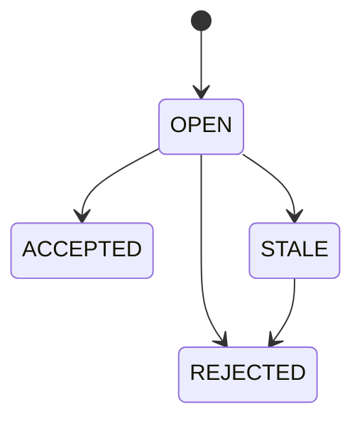

## Запрещено

- `OPEN → ACCEPTED` без действия человека;
- автоматическая активация Rule в момент генерации RuleSuggestion;
- изменение истории решений ради «подгонки» статистики под предложение.

## После ACCEPTED

Результатом является Rule в состоянии `DRAFT` или `ACTIVE` согласно утверждённому процессу доступа. Конкретное право немедленной активации будет закреплено в Access Control Matrix.

---

# 11. CustomerTemplate

## Назначение

CustomerTemplate — конфигурация клиента, включающая настройки модели данных, mappings и применимые правила.

## Принцип версионности

Для MVP CustomerTemplate рассматривается как **версионируемая конфигурация**.

Состояния версии:

- `DRAFT` — версия редактируется и не используется новым анализом;
- `ACTIVE` — текущая версия для новых AnalysisRun;
- `SUPERSEDED` — историческая версия, заменённая более новой.

## Диаграмма

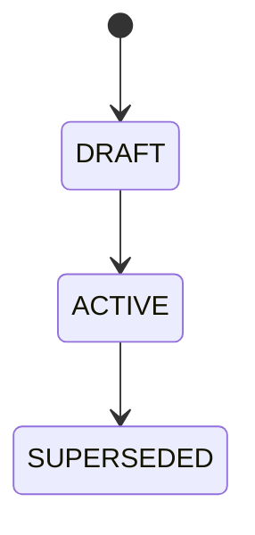

## Инварианты

- В один момент времени у клиента должна быть ровно одна `ACTIVE` версия шаблона.
- Новый AnalysisRun фиксирует идентификатор/версию активного CustomerTemplate.
- Активация новой версии переводит предыдущую `ACTIVE` версию в `SUPERSEDED`.
- Сброс к базовому шаблону не уничтожает историю; он создаёт/активирует новую версию на основе FK baseline.

---

# 12. RawRecord

RawRecord не имеет пользовательского жизненного цикла.

После создания запись считается неизменяемым историческим фактом импорта:

```text
CREATED → immutable
```

Разрешено добавлять связанные результаты обработки, но запрещено переписывать raw value так, будто именно такое значение пришло из источника.

---

# 13. CanonicalEntity и EntityValue

В MVP CanonicalEntity и EntityValue не получают сложный пользовательский workflow.

Они являются текущим внутренним представлением, построенным на основе импортов, mappings и matching. Любое изменение должно сохранять provenance и не уничтожать raw/history.

Состояния `MERGED`, `SPLIT`, `ARCHIVED` и отдельный workflow ручного управления канонической сущностью **не входят в v0.1** и не должны быть придуманы реализацией самовольно.

---

# 14. AuditEvent

AuditEvent неизменяем после записи.

```text
CREATED → immutable
```

Обычные пользователи и бизнес-операции не могут изменять или удалять audit-события.

---

# 15. License State

Лицензия влияет на режим работы FK, но не на принадлежность и доступность данных клиента.

## Состояния

- `ACTIVE`
- `GRACE_PERIOD`
- `READ_ONLY`
- `INVALID`

## Диаграмма

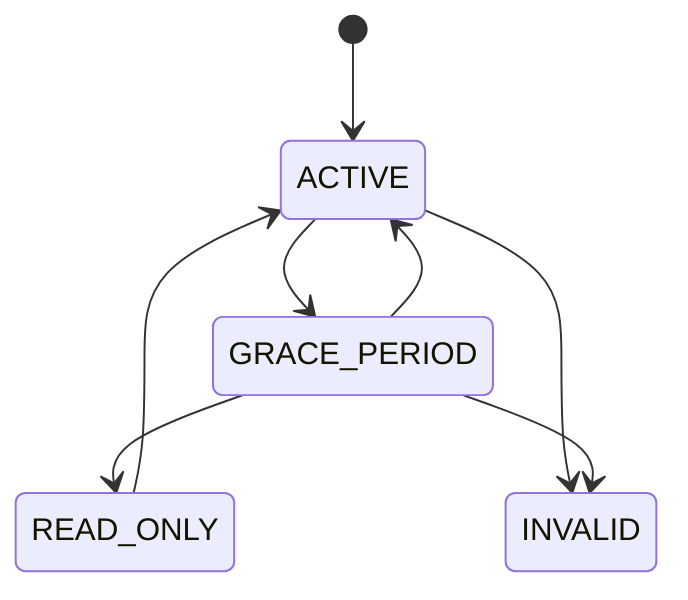

## Правила

- `ACTIVE` — все лицензированные функции доступны.
- `GRACE_PERIOD` — система предупреждает о необходимости продления; допустимый объём новых операций определяется licensing spec.
- `READ_ONLY` — запрещается новое лицензируемое вычисление/обработка, но сохраняются доступ к данным клиента, аудит, экспорт, администрирование и обновление лицензии.
- `INVALID` — подпись или содержимое лицензии не прошло проверку; режим не должен маскироваться под обычное истечение срока.
- Установка новой корректной лицензии может вернуть систему из `READ_ONLY` или `GRACE_PERIOD` в `ACTIVE`.

---

# 16. Сводная цепочка MVP

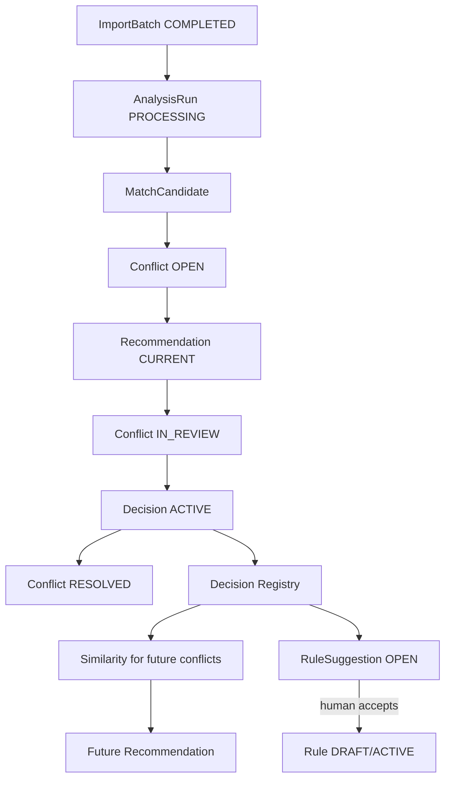

---

# 17. События, обязательные для Audit

Минимально фиксируются:

- создание и завершение ImportBatch;
- начало/завершение AnalysisRun;
- автоматический или подтверждённый результат matching;
- создание Conflict;
- переход Conflict в `IN_REVIEW`;
- создание Recommendation и её версия/основания;
- создание Decision;
- supersede Decision;
- создание, принятие или отклонение RuleSuggestion;
- активация/деактивация Rule;
- активация новой версии CustomerTemplate;
- изменение состояния лицензии.

---

# 18. Требования к API и frontend

Backend обязан валидировать переходы состояний независимо от UI.

Frontend обязан:

- показывать текущий статус объектa;
- показывать только действия, допустимые для данного состояния и роли;
- после операции получать новое состояние от backend;
- не симулировать успешный переход до подтверждения сервером.

При попытке запрещённого перехода API должен возвращать детерминированную доменную ошибку, например:

```json
{
  "error": {
    "code": "INVALID_STATE_TRANSITION",
    "message": "Transition from RESOLVED to IN_REVIEW is not allowed",
    "details": {
      "entity": "Conflict",
      "current_state": "RESOLVED",
      "requested_state": "IN_REVIEW"
    }
  }
}
```

---

# 19. Требования к тестам

Для каждого объекта со state machine должны существовать:

1. тест каждого разрешённого перехода;
2. тест каждого критичного запрещённого перехода;
3. проверка AuditEvent;
4. проверка, что состояние не меняется при ошибке операции;
5. API-тесты на `INVALID_STATE_TRANSITION`;
6. E2E-проверка основного пользовательского пути.

Минимальный E2E:

```text
ImportBatch COMPLETED
→ AnalysisRun COMPLETED
→ Conflict OPEN
→ Recommendation CURRENT
→ Conflict IN_REVIEW
→ Decision ACTIVE
→ Conflict RESOLVED
→ следующий похожий Conflict
→ Recommendation с ссылкой на прошлый Decision
```

---

# 20. Граница v0.1

В v0.1 сознательно не вводятся без отдельного решения:

- автоматическое переоткрытие старого Conflict;
- удаление или редактирование Decision;
- автоматическая активация RuleSuggestion;
- сложный workflow согласования правил;
- merge/split workflow CanonicalEntity;
- массовое автоматическое закрытие конфликтов AI;
- изменение source-систем как следствие перехода статуса.

Если разработка упирается в необходимость одного из этих переходов, это считается архитектурным вопросом, а не местом, где код должен проявить творческую инициативу.


## Stage 6: явный пересмотр того же решения

По Decision Log от 2026-10-23 RESOLVED/INSUFFICIENT_DATA → IN_REVIEW допускается отдельным human command с decision.supersede и ссылкой на текущий head. Это исправление решения по тому же историческому случаю; новая загрузка по-прежнему создаёт новый случай. Старый Decision остаётся head до атомарной записи нового. SELECT_VALUE/ENTER_VALUE → RESOLVED; INSUFFICIENT_DATA → одноимённый статус; DEFERRED → IN_REVIEW. GET не меняет lifecycle. Подробнее: [Human Review](human-review.md).

## Stage 7 technical retrieval execution

IndexRun uses existing AnalysisStatus NEW→QUEUED→PROCESSING→COMPLETED/FAILED; restart resumes PROCESSING checkpoints, explicit retry creates a new run. IndexItem INDEXED/skip-reason is immutable derived checkpoint metadata, not a business state. No new Conflict/Decision transition is introduced. See [retrieval policy](similarity-retrieval.md).
